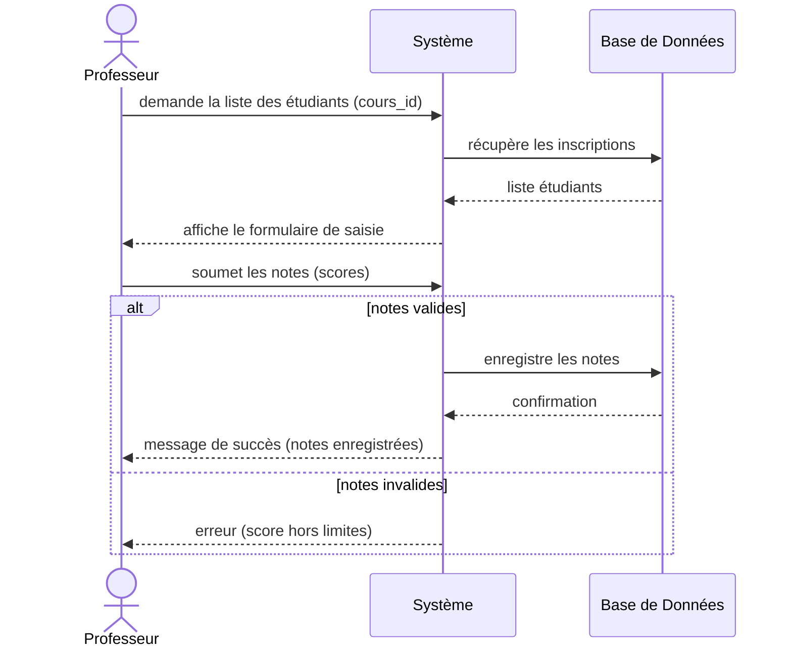
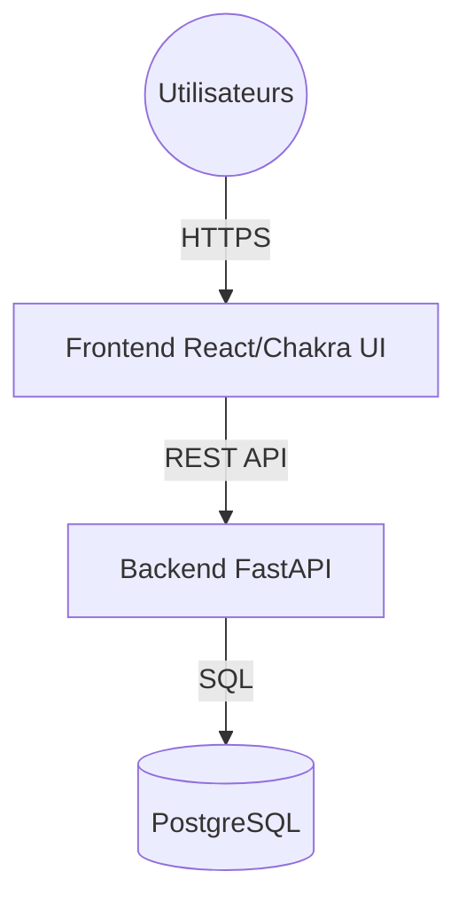
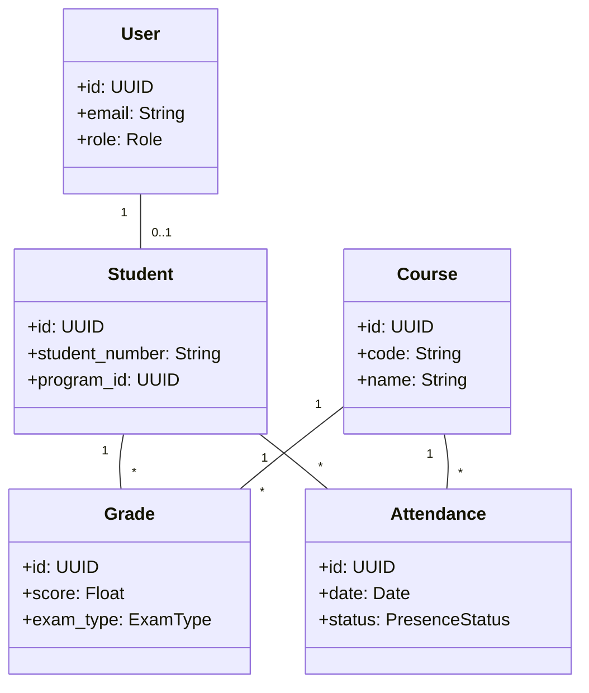

# Système de suivi des présences et des performances des étudiants (UCREH)
## Documentation du Projet

---

### 1- Présentation de l’Organisation
**L’Université Chrétienne de Renaissance du Centre D’Haïti (UCREH)** est une institution d'enseignement supérieur engagée dans la formation académique et spirituelle des étudiants dans la région centrale d'Haïti. Sa mission est de fournir une éducation de qualité tout en promouvant des valeurs chrétiennes et de citoyenneté responsable. L'UCREH opère sous le cadre légal des institutions d'enseignement supérieur privées en Haïti.

### 2- Contexte du Problème Considéré
Actuellement, l'administration de l'UCREH fait face à des défis majeurs dans la gestion manuelle des présences et des performances académiques. Le suivi des étudiants repose sur des registres papier, ce qui ralentit la production de relevés de notes et rend difficile le monitoring en temps réel de l'assiduité. Cette situation justifie l'amorce d'un processus de changement pour éviter les erreurs de saisie et les pertes de données.

### 3- L’inventaire des Problèmes et des Besoins
**Problèmes identifiés :**
- Délais excessifs pour la génération des bulletins.
- Manque de visibilité immédiate sur les absences.
- Difficulté de consolidation des notes entre les différentes sessions.

**Besoins :**
- Système centralisé de gestion des notes et présences.
- Accès sécurisé pour les étudiants à leurs résultats.
- Rapports automatisés pour l'administration.

### 4- Opportunités
La réalisation de ce produit permettra à l'UCREH de :
- Moderniser son image institutionnelle.
- Améliorer la rétention des étudiants grâce à un suivi plus proactif.
- Faciliter le travail des professeurs dans la gestion de leurs classes.

### 5- Les solutions possibles
**Solution Non Informatisée :** Renforcement des procédures papier et augmentation du personnel administratif (Coûteux et peu évolutif).
**Solution Informatisée (Retenue) :** Développement d'une application web full-stack (FastAPI/React) permettant la gestion automatisée et l'accès à distance.

### 6- Les bénéfices et les coûts de chaque solution
| Solution | Bénéfices | Coûts estimatifs |
| :--- | :--- | :--- |
| **Manuelle** | Aucun changement technique | Salaires élevés, frais de papeterie |
| **Informatisée** | Rapidité, Précision, Accessibilité | Développement initial, Maintenance serveur |

### 7- La faisabilité et les risques technologiques
Le projet est techniquement faisable en utilisant une architecture moderne (FastAPI/PostgreSQL). Les risques principaux incluent l'instabilité de l'infrastructure internet et électrique en Haïti, nécessitant une gestion robuste du cache et des sessions.

### 8- Recommandation finale/ Solution Retenue
Il est fortement recommandé de retenir la **Solution Informatisée**. C'est la seule option capable de répondre aux besoins de croissance de l'UCREH et de garantir l'intégrité des dossiers académiques des étudiants.

### 10- Définition du Projet
**Nom du projet :** Système de suivi des présences et des performances des étudiants de l’UCREH.

**Objectif général :** Développer une plateforme numérique pour centraliser les données académiques et automatiser le suivi des étudiants.

**Objectifs spécifiques :**
- Enregistrer les présences via QR Code ou scan manuel.
- Calculer les moyennes pondérées automatiquement.
- Générer des bulletins de session et annuels.
- Fournir un tableau de bord aux administrateurs pour le monitoring des performances.

**Résultats attendus :**
- **Pour les étudiants :** Accès transparent à leurs notes et assiduité.
- **Pour l'administration :** Réduction du temps de traitement des dossiers et meilleure aide à la décision.

### 11- Étude de Faisabilité
- **Faisabilité technique :** Confirmée grâce à l'utilisation de frameworks matures (FastAPI, React) et une base de données relationnelle robuste (PostgreSQL).
- **Faisabilité organisationnelle :** L'UCREH dispose de personnel administratif prêt à être formé à l'outil.
- **Faisabilité économique :** Le coût de mise en œuvre est justifié par la réduction des erreurs et l'amélioration de l'efficacité opérationnelle.

### 12- Limites du projet
Le système ne prendra pas en charge, dans sa première version :
- La gestion financière complète (frais de scolarité).
- L'hébergement de cours en ligne (LMS).
- La gestion des ressources humaines (paie des professeurs).

### 13- Identification des Risques et Mesures d’Atténuation
- **Risque technique :** Panne de serveur. *Mitigation : Backups quotidiens automatisés.*
- **Risque opérationnel :** Résistance au changement du personnel. *Mitigation : Sessions de formation et support technique de 6 mois.*
- **Risque de données :** Fuite d'informations sensibles. *Mitigation : Chiffrement des mots de passe et authentification JWT.*

### 14- Obligations du client
L'UCREH s'engage à :
- Fournir les listes officielles des étudiants et professeurs.
- Assurer une connexion internet dans les locaux administratifs.
- Désigner un responsable projet interne.

### 15- Biens livrables du projet
- **Biens de gestion :** Cahier des charges, Plans de tests, Guide d'utilisation.
- **Biens logiciels :** Code source complet, Base de données configurée, Application déployée.

### 17- Besoins fonctionnels
Le système doit permettre :
- **Gestion des utilisateurs :** Création et gestion des profils (Administrateurs, Professeurs, Étudiants).
- **Gestion académique :** Enregistrement des départements, facultés, programmes et cours.
- **Suivi des présences :** Enregistrement quotidien des présences par cours et session.
- **Gestion des notes :** Saisie des notes d'examens (Intra, Final) et de participation.
- **Génération de documents :** Production de bulletins de session et de relevés de notes annuels.
- **Tableau de bord :** Visualisation des statistiques de performance globale et individuelle.

### 18- Besoins non fonctionnels
- **Performance :** Temps de réponse inférieur à 2 secondes pour les requêtes courantes.
- **Disponibilité :** Système accessible 24/7 (hors maintenance planifiée).
- **Sécurité :** Authentification robuste, gestion fine des permissions (RBAC), et protection contre les injections SQL.
- **Ergonomie :** Interface intuitive et responsive (compatible mobile pour les scans de présence).

### 19- Besoins matériels
- **Serveur :** Serveur dédié ou Cloud (ex: VPS) avec Docker installé.
- **Client :** Ordinateurs de bureau pour l'administration, smartphones/tablettes pour le scan des QR codes par les professeurs ou l'accès étudiant.
- **Infrastructure :** Connexion internet stable et onduleurs pour pallier les coupures d'électricité.

### 20- Besoins humains
- **Équipe de développement :** Développeurs Full-stack pour la maintenance.
- **Administrateur système :** Pour la gestion du serveur et de la base de données.
- **Utilisateurs finaux :** Secrétaires académiques, professeurs et étudiants de l'UCREH.

### 21- Rôles et responsabilités des participants
| Rôle | Responsabilités |
| :--- | :--- |
| **Administrateur (UCREH)** | Gestion globale, création des comptes, configuration des sessions. |
| **Professeur** | Saisie des notes, enregistrement des présences de ses cours. |
| **Étudiant** | Consultation de ses notes et de son assiduité. |
### 22- Description du Système à Mettre en Place
Le système est une application web intégrée permettant la gestion du cycle de vie académique des étudiants. Ses fonctions majeures incluent la gestion des référentiels (programmes, cours), le suivi de l'assiduité par scan de QR code, et la centralisation des évaluations pour le calcul automatique des moyennes et la génération de bulletins PDF.

### 23- Description des utilisateurs
- **Administrateur :** Personnel de l'UCREH avec une maîtrise intermédiaire de l'informatique. Gère les données de base et les accès.
- **Professeur :** Enseignant utilisant le système pour le suivi de ses classes. Requiert une expertise minimale (utilisation d'un navigateur web ou mobile).
- **Étudiant :** Utilisateur final consultant ses propres données académiques via un profil sécurisé.

### 24- Liste des cas d’utilisations
1. **CU01 :** Authentification et gestion du profil (Tous les utilisateurs).
2. **CU02 :** Gestion des dossiers étudiants (Admin).
3. **CU03 :** Configuration des sessions et pondérations (Admin).
4. **CU04 :** Enregistrement des présences par cours (Professeur).
5. **CU05 :** Saisie et modification des notes (Professeur).
6. **CU06 :** Consultation et impression du bulletin (Étudiant/Admin).

### 25- Cas d’utilisation 1 : Saisie des notes (CU05)
**Acteur :** Professeur
**Objectif :** Enregistrer les scores d'une évaluation pour un groupe d'étudiants.
**Pré-conditions :** Le professeur est connecté, la session est active et le cours lui est assigné.
**Scénario nominal :**
1. Le professeur sélectionne le cours et l'évaluation correspondante.
2. Le système affiche la liste des étudiants inscrits.
3. Le professeur saisit les notes.
4. Le système valide que les notes sont comprises entre 0 et le score maximum.
5. Le professeur valide la saisie.
6. Le système enregistre les notes et met à jour les moyennes en temps réel.

### 27- Diagramme de Séquence Système (DSS)
Voici un exemple de DSS pour le cas d'utilisation "Saisie des notes" (CU05) :

### 28- Opérations Système et Contrats
Les opérations principales incluent :
- `creerEtudiant(stats)`
- `enregistrerPresence(cours_id, etudiant_id)`
- `saisirNote(examen_id, etudiant_id, score)`
- `genererBulletin(etudiant_id, annee)`

### 29- Liste des opérations système (Obtenues des DSS)
1. `getStudentList(courseId)`
2. `recordScores(examId, scoreData)`
3. `getTranscript(studentId, year)`
4. `markAttendance(sessionId, studentId)`

### 30- Pour chaque opération système, donnez le contrat
**Contrat pour `recordScores` :**
- **Opération :** `recordScores(examId, scoreData)`
- **Description :** Enregistre les résultats d'un examen pour une liste d'étudiants.
- **Pre-conditions :** L'ID de l'examen existe, l'utilisateur a le rôle Professeur ou Admin.
- **Post-conditions :** Les entrées `Grade` sont créées ou mises à jour dans la base de données. Les moyennes de session sont recalculées.

### 32- Les Exigences
| Numéro | Description | Référence Test |
| :--- | :--- | :--- |
| **REQ01** | Le système doit permettre la saisie des présences par QR Code. | `test_presence_qr` |
| **REQ02** | Le système doit calculer automatiquement le GPA sur une échelle de 4.0. | `test_calculate_gpa` |
| **REQ03** | Seuls les administrateurs peuvent modifier les paramètres globaux. | `test_admin_auth` |
| **REQ04** | Les bulletins doivent être exportables en format PDF. | `test_pdf_export` |

### 33- Architecture Technique Proposée
L'architecture adoptée est une architecture web en trois couches (3-tier) avec conteneurisation Docker.

**Technologies recommandées :**
- **Frontend :** React, TypeScript, Chakra UI v3, TanStack Query.
- **Backend :** Python 3.10+, FastAPI, SQLModel (SQLAlchemy + Pydantic).
- **Base de données :** PostgreSQL.
- **Reverse Proxy :** Traefik (avec gestion automatique des certificats SSL).

### 34- Sécurité du système
- **Authentification :** Gestion via jetons JWT (JSON Web Tokens) avec expiration.
- **Autorisation :** Système de contrôle d'accès basé sur les rôles (RBAC : Admin, Professeur, Étudiant).
- **Protection des données :** Chiffrement des mots de passe avec Passlib (algorithme bcrypt).
- **Journalisation :** Log de toutes les actions sensibles (tentatives de connexion, modification de notes).

### 35- Diagramme de classes (du domaine)

### 36- Diagramme de paquetage de la couche du Domaine
Le domaine est organisé autour des entités centrales : `User`, `Student`, `Course`, `Grade`. Ces paquets ne dépendent d'aucune infrastructure externe, assurant une logique métier pure.

### 38- Interface Graphique du Système
- **Applicabilité du manuel :** Ce guide s'applique à la version 1.0 du système UCREH, fonctionnant sur les navigateurs modernes (Chrome, Firefox, Safari) et optimisé pour une utilisation mobile et desktop.
- **Conventions :** L'interface utilise les standards Material Design via Chakra UI. Les boutons d'action primaire sont en bleu UCREH, les alertes d'erreur en rouge, et les messages de succès en vert.

### 39- Procédure pour signaler et rapporter les erreurs
En cas de dysfonctionnement, l'utilisateur doit :
1. Noter le message d'erreur affiché à l'écran.
2. Prendre une capture d'écran si possible.
3. Envoyer un rapport via le formulaire de support intégré ou par email à `support-it@ucreh.edu.ht` en précisant son identifiant et l'action effectuée.

### 40- Les fonctionnalités offertes aux utilisateurs du système
**Mode Pédagogique - Guide de démarrage rapide :**
1. **Connexion :** Entrez votre email et mot de passe sur la page `accueil`.
2. **Dashboard :** Visualisez le résumé de vos cours ou statistiques.
3. **Saisie de Présence (Professeur) :** Naviguez vers "Sessions", scannez le QR code de l'étudiant ou cochez manuellement.
4. **Consultation de Bulletin (Étudiant) :** Allez dans "Mon Profil" > "Bulletins", sélectionnez l'année et cliquez sur "Voir".

### 41- Information connexe
- **Regroupements :** Les cours sont regroupés par programmes et niveaux d'année.
- **Notes :** Le système de notation suit les standards internationaux (GPA 4.0).

### 43- Maquettes
L'application dispose d'interfaces modernes et épurées. Les maquettes principales incluent :
1. **L'écran de connexion :** Design minimaliste avec authentification sécurisée.
2. **Le Dashboard Administrateur :** Cartes de statistiques (Total étudiants, Taux de présence, Alertes de performance).
3. **Le Bulletin de Session :** Format tabulaire clair, prêt pour l'impression A4.

### 44- Estimation des Ressources et du Budget sur ce qu'il reste à faire
Pour la finalisation et l'exploitation à long terme, les estimations sont les suivantes :
- **Hébergement Cloud :** Env. 20-50 USD/mois (selon le trafic).
- **Support & Maintenance :** Env. 10 heures/mois pour les mises à jour de sécurité et le support utilisateur.
- **Évolutions futures (Optionnel) :** Budget à prévoir pour l'intégration des frais de scolarité (Module Finance).

### 45- Conclusion Générale
La mise en place du **Système de suivi des présences et des performances des étudiants** représente une avancée majeure pour l'UCREH. En automatisant les processus académiques critiques, l'université garantit une meilleure fiabilité de ses données, une productivité accrue pour son personnel et un service de qualité supérieure pour ses étudiants. Ce projet jette les bases d'une transformation numérique durable de l'institution.
